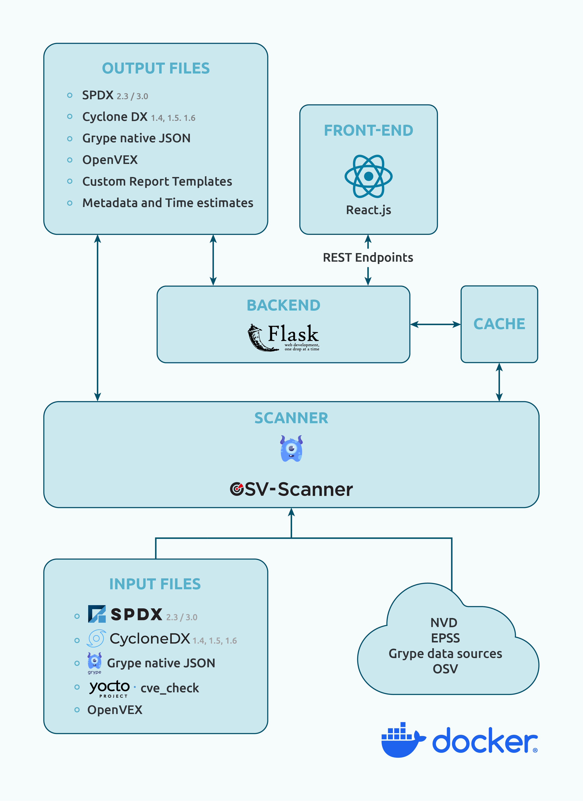

= VulnScout
Savoir-faire Linux
:url-repo: https://github.com/savoirfairelinux/vulnscout
:source-highlighter: highlight.js

image::https://img.shields.io/badge/License-GPL%203.0-green.svg[License, link=https://opensource.org/license/gpl-3-0]

---

== :small_blue_diamond:  Introduction

VulnScout is designed to analyse and identify vulnerabilities in their software components and dependencies using an *SBOM* (Software Bill Of Materials).

It pulls known vulnerabilities from public sources like the NVD, EPSS, and Grype to figure out which parts of a codebase might be affected by security issues (CVE).

VulnScout also provides a web interface for visualisation and a command line to generate enriched output files.

=== VulnScout Features

* Analyse SBOMs (SPDX 2/3, CycloneDX, Yocto CVE check, OpenVEX, Grype)
* Detect and enrich vulnerabilities from NVD, EPSS, and Grype
* Manage projects and variants for multi-target builds
* Web interface for visualisation, triage, and assessment
* Non-interactive / CI mode with configurable match conditions
* Generate customisable reports (AsciiDoc, HTML, PDF, CSV)
* Export enriched SBOMs (SPDX 3.0, CycloneDX 1.6, OpenVEX)
* Custom CVSS scoring per vulnerability
* Time estimation tracking for remediation effort

==  :wrench: Setting up VulnScout

=== Requirements & Installation

VulnScout is designed to run locally in a Docker container.
It only requires `docker` to be installed and running on your host.

To install VulnScout, you only need to clone the repository:
[source,bash]
----
git clone https://github.com/savoirfairelinux/vulnscout.git
cd vulnscout
----

==  :penguin: Using VulnScout

===  Run VulnScout in interactive mode

This project contains default examples of VulnScout.

To run VulnScout demo in interactive mode, you can simply run the command:
[source,shell]
----
./vulnscout add --spdx $(pwd)/example/yocto-wrynose-spdx3/core-image-minimal-qemux86-64.rootfs.spdx.json \
  --cve-check $(pwd)/example/yocto-wrynose-spdx3/core-image-minimal-qemux86-64.rootfs.json
./vulnscout serve
----

Then open your browser to view the results:

[source,plaintext]
----
http://localhost:7275
----

If you don't need additional source files, start the web UI alone:

[source,shell]
----
./vulnscout serve
----

It is also possible to add sources files on a specific project and variant with `-p`/`--project` and `-v`/`--variant`:
[source,shell]
----
./vulnscout -p demo -v x86 add --spdx $(pwd)/example/yocto-wrynose-spdx3/core-image-minimal-qemux86-64.rootfs.spdx.json \
--cve-check $(pwd)/example/yocto-wrynose-spdx3/core-image-minimal-qemux86-64.rootfs.json
----

=== Bundled example data

The `example/` directory contains separate datasets for Yocto and Zephyr:

[cols="1,2",options="header"]
|===
|Directory |Contents
|`example/yocto-wrynose-spdx3/` |Yocto Wrynose SPDX 3 JSON-LD and CVE-check JSON
|`example/yocto-scarthgap-spdx2/` |Yocto Scarthgap SPDX 2 archive and CVE-check JSON
|`example/yocto-scarthgap-cdx/` |Yocto CycloneDX SBOM/VEX
|`example/zephyr/` |Zephyr West-generated SPDX 3 JSON-LD companion documents
|===

To import the Zephyr example, pass all four companion documents in the same
command so their cross-document references can be resolved:

[source,shell]
----
./vulnscout -p zephyr_demo -v mbedtls_native_sim add \
  --spdx "$(pwd)/example/zephyr/app.jsonld" \
  --spdx "$(pwd)/example/zephyr/build.jsonld" \
  --spdx "$(pwd)/example/zephyr/modules-deps.jsonld" \
  --spdx "$(pwd)/example/zephyr/zephyr.jsonld"
./vulnscout serve
----

The Zephyr SBOMs describe the component inventory. Run `vulnscout scan all`
to request vulnerability discovery; scanners may require network access and credentials.
See link:doc/source/examples.md[Bundled Examples] for commands for every dataset,
including the SPDX 2 archives and CycloneDX exports.

== :book: Documentation

Full documentation is available at https://vulnscout.readthedocs.io/

===  MCP Server Source

The VulnScout MCP server source is now vendored in this repository under
`vulnscout_mcp/`.

It is launched as a stdio process by MCP clients (for example VS Code /
Copilot) via `vulnscout_mcp/run_server.py`.

===  Container Lifecycle

The `vulnscout` script manages the container lifecycle. The container runs in the background and accepts commands via `docker exec`.

[source,shell]
----
# Start the container (done automatically by most commands)
./vulnscout start

# Stop and remove the container
./vulnscout stop

# Restart the container (useful after changing config)
./vulnscout restart
----

NOTE: Releases before v0.24 used flags instead of commands. They still work until v0.26 and print a deprecation warning. See link:doc/source/vulnscout-script.md#migrating-from-the-flag-syntax[Migrating from the flag syntax].

===  Projects and Variants

VulnScout organises data into *projects* and *variants*. A project typically maps to a product, and variants represent different builds or architectures (e.g. `x86_64`, `aarch64`).

Select them with `-p, --project` and `-v, --variant`. Each command documents how it uses them (see link:doc/source/vulnscout-script.md#commands[commands reference]); commands that do not use a scope reject these options.

[source,shell]
----
./vulnscout -p <name> -v <name> <command>
----

===  Adding Input Files to the Database

VulnScout accepts multiple input file types through `add`. Repeat an option or mix types in one call; the inputs are processed together.

[source,shell]
----
# SPDX 2/3 SBOM (JSON, tag-value, or .tar/.tar.gz/.tar.zst archive)
./vulnscout add --spdx <path>

# Yocto CVE check JSON output
./vulnscout add --cve-check <path>

# Yocto VEX JSON output (from vex.bbclass)
./vulnscout add --yocto-vex <path>

# CycloneDX file
./vulnscout add --cdx <path>

# OpenVEX file
./vulnscout add --openvex <path>

# Grype file
./vulnscout add --grype <path>
----

Repeat or mix input options in one `add` call:

[source,shell]
----
./vulnscout -p demo -v x86 add \
  --spdx /path/to/sbom.spdx.json \
  --cve-check /path/to/cve-check.json \
  --openvex /path/to/assessments.openvex.json
----

[TIP]
====
- `.tar`, `.tar.gz`, `.tar.zst` archives are supported as SPDX 2 input.
- `.spdx` files (tag-value format) are supported as SPDX 2 input.
- `.spdx.json` is supported as SPDX 3 input.
- Grype scan files should end with `.grype.json`.
- To ignore parsing errors for malformed SBOMs, set: `IGNORE_PARSING_ERRORS=true`
====

===  Run VulnScout with Yocto

We have a dedicated layer for VulnScout integration in Yocto.

You can find the layer here: https://github.com/savoirfairelinux/meta-vulnscout

To be short, a simple `inherit vulnscout` in your image recipe will be enough to configure vulnscout for your project.

The vulnscout web interface can be started with a `bitbake <image-recipe> -c vulnscout` command.

=== Web Interface Settings

The web interface includes a *Settings* tab that provides:

* *Rename Project* — Select a project and give it a new name (must be unique across all projects).
* *Rename Variant* — Select a variant within a project and rename it (must be unique within the project).
* *Import SBOM* — Upload an SBOM file directly from the browser instead of `vulnscout add`.
  When importing, you must select (or create) the target project and variant.
  Supported formats are auto-detected or can be specified explicitly: SPDX (2/3), CycloneDX, OpenVEX, Yocto CVE check, and Grype.

=== Run VulnScout in non-interactive mode

If you want to use the non-interactive mode, without the web interface, you can use `match-condition`:

[source,shell]
----
./vulnscout -p demo match-condition "((cvss >= 9.0 or (cvss >= 7.0 and epss >= 30%)) and (pending or affected))"
----

The command exits with code `2` if any vulnerability matches the condition, enabling use in CI pipelines.

Match conditions evaluate vulnerability data already stored by VulnScout. They do not automatically refresh EPSS or other provider data. Run `vulnscout refresh` before `match-condition` when the condition must use current enrichment data.

See the link:doc/source/ci_conditions.md[match conditions documentation] for the full condition syntax and token reference.

In CI, import the inputs and then run `match-condition` last:

[source,shell]
----
./vulnscout -p demo add --spdx /path/to/sbom.spdx.json --cve-check /path/to/cve-check.json
./vulnscout -p demo match-condition "((cvss >= 9.0) and (pending or affected))"
----

===  Refreshing Vulnerability Data

Use `refresh` to enrich vulnerabilities with current EPSS, NVD, ENISA EUVD, and GitHub Advisory data. After importing new inputs, refresh the same project:

[source,shell]
----
./vulnscout -p demo add --spdx /path/to/sbom.spdx.json
./vulnscout -p demo refresh
----

`refresh` also works on its own. Without a project it refreshes all vulnerabilities; project and variant options restrict the scope:

[source,shell]
----
./vulnscout refresh
./vulnscout -p demo refresh
./vulnscout -p demo -v x86 refresh
----

The refresh enriches existing CVE and GHSA records; it does not discover new findings. A variant requires its project because variant names are project-local.

===  Performing a Grype Scan

VulnScout can run Grype on the current database contents. This exports the current state as a CycloneDX SBOM, runs Grype against it, and merges the results back:

[source,shell]
----
./vulnscout -p demo -v x86 scan grype
----

To scan newly added files, run `add` and then `scan` with the same scope:

[source,shell]
----
./vulnscout -p demo add --spdx example/yocto-wrynose-spdx3/core-image-minimal-qemux86-64.rootfs.spdx.json
./vulnscout -p demo scan grype
----

`scan` accepts `grype`, `nvd` (CPE-based), `osv` (PURL-based), and `sbom-cve-check` (local advisory databases). Select several with commas (`scan nvd,osv`) or spaces (`scan nvd osv`). With no type, or with `all`, every available scanner runs. Scans always run in the order Grype, NVD, OSV, sbom-cve-check. Vulnerability-data refresh is a separate command (`refresh`).

`scan grype` can consume significant RAM when the SBOM contains many packages.
By default VulnScout caps Grype's memory at ~80 % of the container/cgroup limit.
Override with the `GRYPE_MEMLIMIT` environment variable (see the Environment Variables table above).

[source,shell]
----
# Persistent: keep Grype below 6 GiB across all future scans in this container
./vulnscout config set GRYPE_MEMLIMIT 6GiB

# One-off: override via the host environment before starting the container
export GRYPE_MEMLIMIT=24GiB
./vulnscout -p demo -v x86 scan grype
----

===  Generating Reports

Reports are generated from AsciiDoc templates. VulnScout ships with built-in templates and also supports custom ones.
Use `-p` to select the report scope; when omitted, the `default` project is used. A project report includes all its variants. Add `-v` to restrict the report to one variant in that project. Unknown project or variant names fail instead of broadening the report scope.

[source,shell]
----
# Generate a report from a built-in template
./vulnscout -p demo report summary.adoc

# Generate a report for one variant only
./vulnscout -p demo -v x86 report summary.adoc

# Generate a match-condition report (lists vulnerabilities that triggered the condition)
./vulnscout -p demo report match_condition.adoc --condition "cvss >= 9.0"

# Register a custom template permanently in the container and generate a report
./vulnscout -p demo report /path/to/my-custom-report.adoc

# Then generate a report from it by name
./vulnscout -p demo report my-custom-report.adoc

# Or pass the file path directly — registers and runs it in one step
./vulnscout -p demo report /path/to/my-custom-report.adoc
----

`--condition` fills the report's list of matching vulnerabilities. A match does not fail `report`; use `match-condition` to fail a CI job. `--format pdf` or `--format html` overrides the format implied by the template extension.

Multiple reports can be generated in one command:

[source,shell]
----
./vulnscout -p demo report summary.adoc all_assessments.adoc
----

Reports are written to the outputs directory (default: `.vulnscout/outputs/`).

See the link:doc/source/templates.md[report templates documentation] for documentation on writing custom report templates.

===  Exporting SBOM Files

VulnScout can export the enriched project data as standard SBOM formats. Exported files are written to the outputs directory (default: `.vulnscout/outputs/`).

[source,shell]
----
# Export as SPDX 3.0 SBOM
./vulnscout -p demo export spdx

# Export as CycloneDX 1.6 SBOM
./vulnscout -p demo export cdx

# Export as OpenVEX document (vulnerabilities + assessments)
./vulnscout -p demo export openvex
----

One `export` call can write several formats:

[source,shell]
----
./vulnscout -p demo export spdx cdx openvex
----

===  Exporting and Importing Custom Assessments

VulnScout lets you export and re-import the assessments you have manually created through the web interface (review / triage decisions). This is useful for:

* Backing up your review work before re-importing SBOMs.
* Sharing assessment decisions across different VulnScout instances.
* Restoring triage state in CI pipelines after a database reset.

==== VulnScout JSON

`export custom-data` exports custom assessments, CVSS scores, and time estimates as one VulnScout JSON file. It includes every variant in the selected project unless `-v` is provided.

[source,shell]
----
# Export all project variants
./vulnscout -p demo export custom-data

# Export one variant
./vulnscout -p demo -v x86 export custom-data

# Update the existing export with current review data
./vulnscout -p demo export custom-data --amend
----

Add `--amend` to reconcile current review data with the existing file in the output directory. The file must already exist at the path produced by the same export scope. Existing records retain stable ordering and extension fields while updated and new records are incorporated.

`import custom-data` restores entries according to the variant metadata stored in the file, so it rejects `-v`. Imported assessments use the current system time by default. Add `--timestamps original` to preserve assessment timestamps from the file; `--timestamps current` selects the default explicitly.

Current version 2 exports identify assessment targets by variant name and package, without instance-local variant UUIDs, so they can be shared between VulnScout installations. Legacy version 1 files remain importable; unsupported future versions are rejected explicitly.

[source,shell]
----
./vulnscout -p demo import custom-data /path/to/custom_vulnscout_data_all.json

./vulnscout -p demo import custom-data /path/to/custom_vulnscout_data_all.json --timestamps original
----

==== OpenVEX

OpenVEX custom-assessment transfers operate on one JSON document. With `-v`,
`export custom-openvex` writes that variant; without it, it writes one document
per variant that has custom assessments (`custom_openvex_<variant>.json`), and
removes the file of a variant that no longer has any. `import
custom-openvex` imports into `-v`, or into the project's only variant when `-v`
is omitted. If the project has several variants, it exits with code 1 and lists
them; import each per-variant file with its own `-v`.

[source,shell]
----
# Export a variant
./vulnscout -p demo -v x86 export custom-openvex

# Update the existing OpenVEX export
./vulnscout -p demo -v x86 export custom-openvex --amend

# Import into a variant
./vulnscout -p demo -v x86 import custom-openvex /path/to/custom_openvex_x86.json

# Ignore OpenVEX statement timestamps and use the current system time
./vulnscout -p demo -v x86 import custom-openvex /path/to/custom_openvex_x86.json --timestamps current
----

For OpenVEX exports, `--amend` preserves the document ID and statement ordering from the existing output file and increments its version.

OpenVEX imports preserve statement timestamps by default. Add
`--timestamps current` to use the current system time, or
`--timestamps original` to select the default explicitly.

A typical restore runs one command per step:

[source,shell]
----
./vulnscout -p demo add --spdx /path/to/sbom.spdx.json
./vulnscout -p demo import custom-data /path/to/custom_vulnscout_data_all.json
./vulnscout -p demo export spdx
./vulnscout -p demo report summary.adoc
----

Exports and reports now run after the import. The legacy call ran them before it.

=== Configuration

==== Configuration Commands

Persistent configuration is stored in `.vulnscout/cache/config.env` and is automatically loaded on each run.

[source,shell]
----
# Set a config value
./vulnscout config set <key> <value>

# Print one value
./vulnscout config get <key>

# List current configuration (sensitive values masked)
./vulnscout config list

# Remove a config key
./vulnscout config unset <key>
----

Example — set an NVD API key for higher rate limits:

[source,shell]
----
./vulnscout config set NVD_API_KEY abc123
----

==== Environment Variables

The following environment variables can be set via `vulnscout config` or exported before running:

.Container & runtime
[cols="1,2,1"]
|===
|Variable |Description |Default

|`VULNSCOUT_CONTAINER`
|Name of the Docker container
|`vulnscout`

|`VULNSCOUT_IMAGE`
|Docker image to use
|`docker.io/sflinux/vulnscout:v0.23`

|`VULNSCOUT_BUILD_DIR`
|Root build directory on the host (parent of `cache/` and `outputs/`)
|`./.vulnscout`

|`VULNSCOUT_OUTPUTS_DIR`
|Directory for output files on the host
|`$VULNSCOUT_BUILD_DIR/outputs`

|`VULNSCOUT_CACHE_DIR`
|Cache directory on the host (holds the SQLite database and config)
|`$VULNSCOUT_BUILD_DIR/cache`

|`FLASK_RUN_PORT`
|Port the web UI listens on
|`7275`

|`FLASK_RUN_HOST`
|Host address for the web UI
|`0.0.0.0`

|`VITE_API_URL`
|Backend API URL used by the dev frontend
|`http://localhost:7275`

|`USER_UID`
|UID used to write output files (avoids permission issues)
|current user

|`USER_GID`
|GID used to write output files
|current group
|===

.Scan & enrichment
[cols="1,2,1"]
|===
|Variable |Description |Default

|`NVD_API_KEY`
|NVD API key for higher rate limits (https://nvd.nist.gov/developers/request-an-api-key)
|_(none)_

|`GRYPE_MEMLIMIT`
|Cap the RAM used by the `grype` binary (Go soft memory limit, `GOMEMLIMIT`). Accepts the same unit strings as Go: `4GiB`, `8192MiB`, plain bytes. Set to `off` to disable. Default (unset): auto (~80 % of the container/cgroup memory limit, recommended for CI).
|_(auto)_

|`IGNORE_PARSING_ERRORS`
|Continue scanning even if input files contain errors
|`false`

|`VERBOSE_MODE`
|Enable verbose logging in the container
|`false`
|===

.Report metadata
[cols="1,2,1"]
|===
|Variable |Description |Default

|`PRODUCT_NAME`
|Product name embedded in generated reports and SBOMs
|_(none)_

|`PRODUCT_VERSION`
|Product version embedded in generated reports
|_(none)_

|`AUTHOR_NAME`
|Author/company name embedded in reports
|_(none)_

|`CLIENT_NAME`
|Customer/client company name embedded in reports (optional, may be empty)
|_(none)_

|`CONTACT_EMAIL`
|Contact email embedded in reports
|_(none)_

|`DOCUMENT_URL`
|URL embedded in exported SBOM documents
|_(none)_
|===

==== HTTP Proxy Configuration

If you want to run VulnScout with an HTTP proxy, set variables in the config:

[source,shell]
----
./vulnscout config set HTTP_PROXY http://proxy.example.com:8080
./vulnscout config set HTTPS_PROXY http://proxy.example.com:8080
./vulnscout config set NO_PROXY localhost,127.0.0.1
----

Or pass them directly as environment variables when calling `vulnscout`.

== :mag_right: Architecture

=== :inbox_tray: Supported input files

* SPDX 2.3 (Packages) - JSON and tag-value formats
* SPDX 3.0 (Packages + vulnerabilities)
* Cyclone DX 1.4, 1.5, 1.6 (Packages + vulnerabilities)
* Grype native JSON format (Packages + vulnerabilities)
* Yocto JSON output of `cve-check` module (Packages + vulnerabilities)

=== :outbox_tray: Supported output files

* SPDX 2.3 (Packages)
* SPDX 3.0 (Packages + vulnerabilities)
* Cyclone DX 1.4, 1.5, 1.6 (Packages + vulnerabilities)
* openVex (vulnerabilities + assessments)
* All reports: Asciidoc, HTML, PDF
* Summary: Asciidoc, HTML, PDF
* Time estimates: csv
* Vulnerabilities: csv, txt

=== :bar_chart: Vulnerability Data Sources

.The tool pulls vulnerability and risk data from multiple trusted sources:

* NVD (National Vulnerability Database)
* All data sources supported by Grype
* EPSS (Exploit Prediction Scoring System)
* Information embedded in input files

=== :pencil: Custom CVSS Scoring

VulnScout allows you to add a custom CVSS vector string to a vulnerability, enabling organisation-specific vulnerability scoring.

== :clipboard: Licence

`Copyright (C) 2017-2026 Savoir-faire Linux, Inc.` +
VulnScout is released under the GPL-3.0 license.

