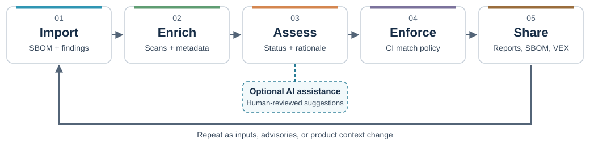
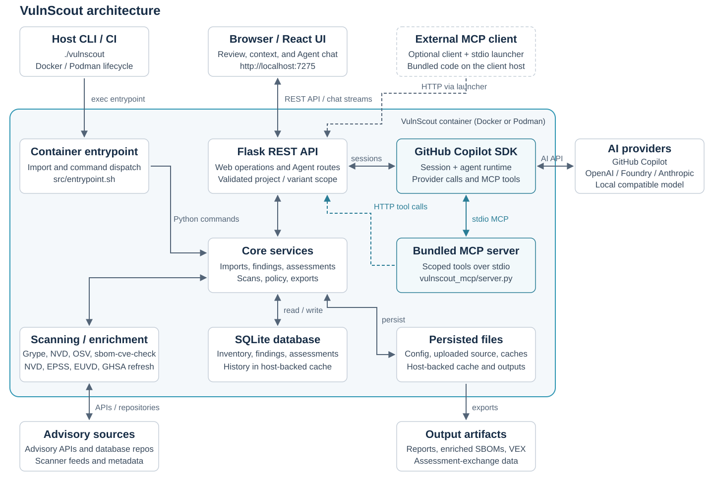

= VulnScout
Savoir-faire Linux
:url-repo: https://github.com/savoirfairelinux/vulnscout
:source-highlighter: highlight.js

image::https://img.shields.io/badge/License-GPL--3.0--only-green.svg[GPL-3.0-only,link=LICENSE.GPL-3.0-only]

VulnScout is an open-source, SBOM-first platform for identifying, assessing,
and managing vulnerabilities in software components and dependencies.
Import a *Software Bill of Materials (SBOM)*, investigate findings in the web
interface, record product-specific assessments, and automate policy checks in CI.

https://vulnscout.io/[Website] |
https://vulnscout.readthedocs.io/[Documentation] |
{url-repo}[Source code]

== Full Pipeline

VulnScout starts after SBOM generation and supports a repeatable lifecycle:
*Import -> Enrich -> Assess -> Enforce -> Share*.

Scanning discovers additional findings; refreshing updates metadata for findings
already recorded. Assessments connect those findings to product evidence.
AI assistance is optional, and proposed AI assessments require human approval
before becoming official.

The stages describe a logical lifecycle, not a mandatory shell sequence.
In CI, generate required reports and exports *before the final
`match-condition`*, so a policy failure does not prevent artifact creation.
See link:doc/source/vulnscout-workflow.md[VulnScout Workflow] for each stage
and its detailed task guides.

== Features

* Import SPDX 2/3 JSON, SPDX 3 JSON-LD, and CycloneDX JSON, along with Yocto
  CVE-check/VEX, OpenVEX, and Grype JSON findings.
* Discover vulnerability candidates with *Grype, NVD, OSV, and sbom-cve-check*.
* Enrich existing vulnerabilities with *NVD, EPSS, ENISA EUVD, and GitHub
  Advisory* metadata.
* Manage projects and variants, inspect package dependencies, and compare
  scan history without mixing build-specific evidence.
* Triage findings in the web interface, record VEX assessments, customize CVSS
  scores, and estimate remediation effort.
* Use the built-in *SDK-backed Agent* for AI-assisted assessments and independent
  reviews of custom assessments.
* Enforce executable vulnerability policies in CI using match conditions.
* Generate customizable reports and export enriched SPDX, CycloneDX, OpenVEX,
  or VulnScout assessment-exchange data.

SPDX tag-value input is not supported by the current import pipeline.
See link:doc/source/cli-inputs.md[Input Sources] and
link:doc/source/exports.md[Exporting SBOM Files] for format details.

== Quick Start

On the host, you need a working *Docker or Podman* setup that your user can run.
VulnScout runs inside the container; normal use does not require a host Python
or Node.js installation.

Clone the repository, import the bundled Yocto example, then start the interface:

[source,bash]
----
git clone https://github.com/savoirfairelinux/vulnscout.git
cd vulnscout
./vulnscout add \
  --spdx "$(pwd)/example/yocto-wrynose-spdx3/core-image-minimal-qemux86-64.rootfs.spdx.json" \
  --cve-check "$(pwd)/example/yocto-wrynose-spdx3/core-image-minimal-qemux86-64.rootfs.json"
./vulnscout serve
----

The launcher pulls the image if needed, starts the container, and imports the
supplied packages and findings.
Import alone does not request additional scans or a complete metadata refresh.

Open http://localhost:7275/ and select project *default* and variant *default*
in the navigation bar, then open *Vulnerabilities*.
A *project* groups a software product's data; a *variant* represents a build,
target, or deployment within it.
Place `-p <project>` and `-v <variant>` after the command when selecting a
different scope.

On subsequent runs, use `./vulnscout serve` without reimporting the same data.
Press `Ctrl+C` to stop the web server; the container remains running.
To stop and remove the container:

[source,bash]
----
./vulnscout stop
----

By default, the database and configuration remain in `.vulnscout/cache/`, and
exports remain in `.vulnscout/outputs/` beside the launcher. Stopping the
container does not reset them.

For custom runtime settings, follow
link:doc/source/cli-configuration.md[Container Lifecycle and Configuration].

See link:doc/source/getting-started.md[Getting Started] for the full first-run
guide and link:doc/source/examples.md[Bundled Examples] for alternative Yocto
and Zephyr datasets with their project/variant-scoped commands.

== Architecture

The host launcher manages Docker/Podman and invokes the container entrypoint.
The React interface communicates with the Flask REST API. Both paths use the
same core services and persisted project/variant data.

The embedded Agent uses the *GitHub Copilot SDK* and its agent runtime to
communicate with the selected AI provider and invoke the bundled MCP server
over stdio. MCP tools call VulnScout's REST API rather than accessing the
database directly. The embedded Agent has no shell, arbitrary filesystem,
or web research tools; source evidence is provided through uploaded references.

The embedded Agent is *localhost-only and single-user*. Provider credentials
stay on the backend, but assessment context and source evidence may be sent
to the selected AI provider; only share data you are authorized to disclose.
See link:doc/source/ai-assessments.md[AI Assessments] for provider setup and
human approval, or link:doc/source/agent-chat.md[AI Agent Development] for
configuration and implementation details.

External MCP clients remain an optional alternative using the server bundled
in this repository; no separate MCP repository is required. See
link:doc/source/ai-external-clients.md[External AI Clients].

== Documentation and Integrations

Full rendered documentation is available at https://vulnscout.readthedocs.io/.
The links below also provide the documentation sources for this checkout.

[cols="1,2",options="header"]
|===
|Guide |Purpose
|link:doc/source/getting-started.md[Getting Started] |Requirements, first import, and web startup
|link:doc/source/vulnscout-workflow.md[VulnScout Workflow] |Import, enrich, assess, enforce, and share
|link:doc/source/vulnscout-script.md[VulnScout CLI] |Command syntax and project/variant scope
|link:doc/source/interactive-mode.md[Interactive Mode] |Web-interface tasks and assessment guidance
|link:doc/source/ai-assessments.md[AI Assessments] |Embedded Agent, source evidence, and human review
|link:doc/source/api.md[REST API] |HTTP operations and interactive OpenAPI documentation
|link:doc/source/templates.md[Writing Report Templates] |Custom reports and assets
|link:doc/source/dev_guide.md[Developer's Guide] |Development, tests, and documentation builds
|===

Integrate generated build outputs through
link:doc/source/yocto-integration.md[Yocto Integration] or
link:doc/source/zephyr-integration.md[Zephyr Integration].
For advanced container-managed and CI setups, see
link:doc/source/container-entrypoint.md[Using Container Entrypoint].

Migrating older automation? See
link:doc/source/cli-migration.md[Migrating from Legacy CLI Flags].

== Essential CLI Commands

These are task examples, not a script to run from top to bottom. Replace the
sample paths, project `demo`, and variant `x86` with your own.

=== Import Inputs

Import an SPDX SBOM together with its CVE-check findings, or use a CycloneDX SBOM:

[source,bash]
----
./vulnscout add -p demo -v x86 \
  --spdx /path/to/sbom.spdx.json --cve-check /path/to/cve-check.json

./vulnscout add -p demo -v x86 --cdx /path/to/bom.json
----

Options can repeat or mix in one import. See
link:doc/source/cli-inputs.md[Input Sources] for Yocto VEX, OpenVEX, Grype,
archives, and supported filenames.

=== Scan and Refresh

Scanning discovers findings; refreshing enriches findings already recorded.
Importing does not automatically run either operation.

[source,bash]
----
./vulnscout scan -p demo -v x86 grype osv
./vulnscout refresh -p demo -v x86
----

Use `all` instead of `grype osv` to run every scanner. Scanners may require
network access and advisory database downloads; see
link:doc/source/vulnerability-scanning.md[Vulnerability Scanning] and
link:doc/source/vulnerability-data.md[Refresh Vulnerability Data].

=== Generate Reports and Export Results

[source,bash]
----
./vulnscout report -p demo -v x86 summary.adoc
./vulnscout export -p demo -v x86 spdx cdx openvex
----

Outputs are written to `.vulnscout/outputs/` by default. Add `--format pdf` to
`report` for PDF output. See link:doc/source/reports.md[Report Generation] and
link:doc/source/exports.md[Exporting SBOM Files].

=== Exchange Custom Assessments

Back up or restore a project's assessments with VulnScout JSON, or exchange
one variant's custom assessments as OpenVEX:

[source,bash]
----
./vulnscout export -p demo custom-data
./vulnscout import -p demo custom-data \
  /path/to/custom_vulnscout_data_all.json

./vulnscout export -p demo -v x86 custom-openvex
./vulnscout import -p demo -v x86 custom-openvex \
  /path/to/custom_openvex_x86.json
----

The JSON examples cover all project variants. `import custom-data` restores
the variants named in the file and does not accept `-v`. See
link:doc/source/cli-assessments.md[Exporting and Importing Custom Assessments]
for timestamps and merge behavior.

=== Enforce a CI Policy

Run the policy check *after* generating required reports and exports, so a
match does not prevent artifact creation in a job that stops on errors:

[source,bash]
----
./vulnscout match-condition -p demo -v x86 \
  "cvss >= 7.0 and (pending or affected)"
----

Exit codes are *0* for no match, *2* for a policy match, and *1* for an execution
error. This checks stored data; it does not scan or refresh it. See
link:doc/source/ci_conditions.md[Writing Match Conditions].

=== Help, Lifecycle, and Configuration

[source,bash]
----
./vulnscout --help
./vulnscout scan --help
./vulnscout list projects
----

Most commands start the container automatically. On a fresh installation,
run `start` before the first `config set` to initialize the configuration:

[source,bash]
----
./vulnscout start
./vulnscout config set GRYPE_MEMLIMIT 6GiB
./vulnscout config get GRYPE_MEMLIMIT
./vulnscout config list
----

Use `config unset GRYPE_MEMLIMIT` to remove that override. Run
`./vulnscout restart` after changes that affect the running web server;
`./vulnscout stop` stops and removes the container without deleting saved data.
See link:doc/source/cli-configuration.md[Container Lifecycle and Configuration]
for runtime settings and which changes require a restart.

== Licence

Copyright (C) 2017-2026 Savoir-faire Linux, Inc.

VulnScout is licensed under link:LICENSE.GPL-3.0-only[GPL-3.0-only].

image::doc/source/_static/SFL.jpeg[Savoir-faire Linux,width=160]
